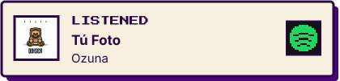
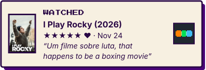
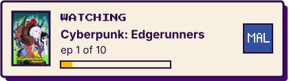
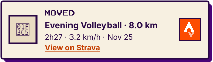

<picture>
  <source media="(max-width: 600px) and (prefers-color-scheme: dark)" srcset="assets/header-phone-dark.svg">
  <source media="(max-width: 600px)" srcset="assets/header-phone-light.svg">
  <source media="(prefers-color-scheme: dark)" srcset="assets/header-dark.svg">
  <source media="(prefers-color-scheme: light)" srcset="assets/header-light.svg">
  
</picture>

**🌐 [Portfolio](https://jvitorcosta.github.io)** · **💼 [LinkedIn](https://www.linkedin.com/in/jvpro/)** · **📄 [Resume (PDF)](https://jvitorcosta.github.io/Vitor_Pinheiro_Resume.pdf)** · ✉️ joaovpro17@gmail.com

## Projects

- **[car-cyberdeck](https://github.com/jvitorcosta/car-cyberdeck)**: a taste of Pokémon nostalgia on my car's dashboard 
  ESP32, C++
- **[car-can-lab](https://github.com/jvitorcosta/car-can-lab)**: listening to my car's CAN bus over Bluetooth to find its signals 
  ESP32, Python
- **[or-solver-streamlit](https://github.com/jvitorcosta/or-solver-streamlit)**: SolvedOR, my bachelor thesis: an app that teaches Operations Research 
  Python, OR-Tools · [live](https://solvedor.streamlit.app)
- **[timeseries-analysis-streamlit](https://github.com/jvitorcosta/timeseries-analysis-streamlit)**: shows where a daily forecast goes wrong: by series, weekday, holiday and benchmark 
  Python, Plotly · [live](https://forecast-error-analysis.streamlit.app)
- **[ask-vitor](https://github.com/jvitorcosta/ask-vitor)**: ask a local LLM about me; it answers only from my CV and says so when it doesn't know 
  FastAPI, Ollama
- **[python-uv-claude-template](https://github.com/jvitorcosta/python-uv-claude-template)**: how I start every Python project 
  Python, uv

## Last 12 months of commits

<picture>
  <source media="(max-width: 600px) and (prefers-color-scheme: dark)" srcset="assets/skyline-phone-dark.svg">
  <source media="(max-width: 600px)" srcset="assets/skyline-phone-light.svg">
  <source media="(prefers-color-scheme: dark)" srcset="assets/skyline-dark.svg">
  <source media="(prefers-color-scheme: light)" srcset="assets/skyline-light.svg">
  
</picture>

## Lately

  
   
  
   
  
   
  
   
  

Header and skyline drawn by [scripts/profile_art.py](scripts/profile_art.py), the skyline inspired by gitskins Contribution City and Neon Skyline · the Lately cards by [scripts/lately_cards.py](scripts/lately_cards.py), in my website's style, from the data my website saves · refreshed daily by GitHub Actions
