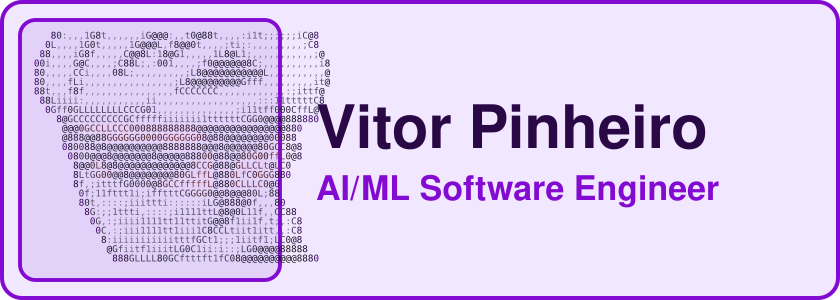
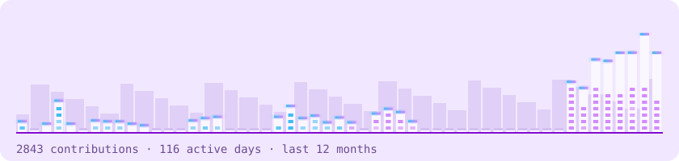
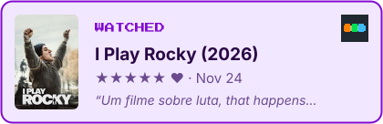
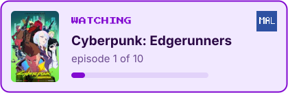
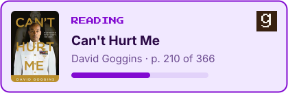
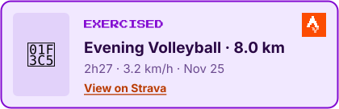

<picture>
  <source media="(max-width: 600px) and (prefers-color-scheme: dark)" srcset="assets/header-phone-dark.svg">
  <source media="(max-width: 600px)" srcset="assets/header-phone-light.svg">
  <source media="(prefers-color-scheme: dark)" srcset="assets/header-dark.svg">
  <source media="(prefers-color-scheme: light)" srcset="assets/header-light.svg">
  
</picture>

**🌐 [Portfolio](https://jvitorcosta.github.io)** · **💼 [LinkedIn](https://www.linkedin.com/in/jvpro/)** · **📄 [Resume (PDF)](https://jvitorcosta.github.io/Vitor_Pinheiro_Resume.pdf)** · ✉️ joaovpro17@gmail.com

## Projects

- **[car-cyberdeck](https://github.com/jvitorcosta/car-cyberdeck)**: a taste of Pokémon nostalgia on my car's dashboard 
  ESP32, C++
- **[car-can-lab](https://github.com/jvitorcosta/car-can-lab)**: listening to my car's CAN bus over Bluetooth to find its signals 
  ESP32, Python
- **[or-solver-streamlit](https://github.com/jvitorcosta/or-solver-streamlit)**: SolvedOR, my bachelor thesis: an app that teaches Operations Research 
  Python, OR-Tools · [live](https://solvedor.streamlit.app)
- **[timeseries-analysis-streamlit](https://github.com/jvitorcosta/timeseries-analysis-streamlit)**: shows where a daily forecast goes wrong: by series, weekday, holiday and benchmark 
  Python, Plotly · [live](https://forecast-error-analysis.streamlit.app)
- **[ask-vitor](https://github.com/jvitorcosta/ask-vitor)**: ask a local LLM about me; it answers only from my CV and says so when it doesn't know 
  FastAPI, Ollama
- **[python-uv-claude-template](https://github.com/jvitorcosta/python-uv-claude-template)**: how I start every Python project 
  Python, uv

## Last 12 months of commits

<picture>
  <source media="(max-width: 1011px) and (prefers-color-scheme: dark)" srcset="assets/skyline-phone-dark.svg">
  <source media="(max-width: 1011px)" srcset="assets/skyline-phone-light.svg">
  <source media="(prefers-color-scheme: dark)" srcset="assets/skyline-dark.svg">
  <source media="(prefers-color-scheme: light)" srcset="assets/skyline-light.svg">
  
</picture>

## Lately

  <a href="https://spotify-now-playing-ashen-two.vercel.app/redirect"><picture><source media="(min-width: 1012px) and (prefers-color-scheme: dark)" srcset="https://spotify-now-playing-ashen-two.vercel.app/api/card.svg?theme=dark&amp;wide=1"><source media="(min-width: 1012px)" srcset="https://spotify-now-playing-ashen-two.vercel.app/api/card.svg?theme=light&amp;wide=1"><source media="(prefers-color-scheme: dark)" srcset="https://spotify-now-playing-ashen-two.vercel.app/api/card.svg?theme=dark"></picture></a>
   
  <a href="https://letterboxd.com/zubu/"><picture><source media="(min-width: 1296px) and (prefers-color-scheme: dark)" srcset="assets/lately-letterboxd-dark.svg 1.014x"><source media="(min-width: 1296px)" srcset="assets/lately-letterboxd-light.svg 1.014x"><source media="(min-width: 1280px) and (prefers-color-scheme: dark)" srcset="assets/lately-letterboxd-dark.svg 1.029x"><source media="(min-width: 1280px)" srcset="assets/lately-letterboxd-light.svg 1.029x"><source media="(min-width: 1215px) and (prefers-color-scheme: dark)" srcset="assets/lately-letterboxd-dark.svg 1.117x"><source media="(min-width: 1215px)" srcset="assets/lately-letterboxd-light.svg 1.117x"><source media="(min-width: 1150px) and (prefers-color-scheme: dark)" srcset="assets/lately-letterboxd-dark.svg 1.224x"><source media="(min-width: 1150px)" srcset="assets/lately-letterboxd-light.svg 1.224x"><source media="(min-width: 1080px) and (prefers-color-scheme: dark)" srcset="assets/lately-letterboxd-dark.svg 1.364x"><source media="(min-width: 1080px)" srcset="assets/lately-letterboxd-light.svg 1.364x"><source media="(min-width: 1012px) and (prefers-color-scheme: dark)" srcset="assets/lately-letterboxd-dark.svg 1.533x"><source media="(min-width: 1012px)" srcset="assets/lately-letterboxd-light.svg 1.533x"><source media="(prefers-color-scheme: dark)" srcset="assets/lately-letterboxd-dark.svg"></picture></a>
  <a href="https://myanimelist.net/animelist/yulong17"><picture><source media="(min-width: 1296px) and (prefers-color-scheme: dark)" srcset="assets/lately-myanimelist-dark.svg 1.014x"><source media="(min-width: 1296px)" srcset="assets/lately-myanimelist-light.svg 1.014x"><source media="(min-width: 1280px) and (prefers-color-scheme: dark)" srcset="assets/lately-myanimelist-dark.svg 1.029x"><source media="(min-width: 1280px)" srcset="assets/lately-myanimelist-light.svg 1.029x"><source media="(min-width: 1215px) and (prefers-color-scheme: dark)" srcset="assets/lately-myanimelist-dark.svg 1.117x"><source media="(min-width: 1215px)" srcset="assets/lately-myanimelist-light.svg 1.117x"><source media="(min-width: 1150px) and (prefers-color-scheme: dark)" srcset="assets/lately-myanimelist-dark.svg 1.224x"><source media="(min-width: 1150px)" srcset="assets/lately-myanimelist-light.svg 1.224x"><source media="(min-width: 1080px) and (prefers-color-scheme: dark)" srcset="assets/lately-myanimelist-dark.svg 1.364x"><source media="(min-width: 1080px)" srcset="assets/lately-myanimelist-light.svg 1.364x"><source media="(min-width: 1012px) and (prefers-color-scheme: dark)" srcset="assets/lately-myanimelist-dark.svg 1.533x"><source media="(min-width: 1012px)" srcset="assets/lately-myanimelist-light.svg 1.533x"><source media="(prefers-color-scheme: dark)" srcset="assets/lately-myanimelist-dark.svg"></picture></a>
   
  <a href="https://www.goodreads.com/user/show/185113793-vitor-pinheiro"><picture><source media="(min-width: 1296px) and (prefers-color-scheme: dark)" srcset="assets/lately-goodreads-dark.svg 1.014x"><source media="(min-width: 1296px)" srcset="assets/lately-goodreads-light.svg 1.014x"><source media="(min-width: 1280px) and (prefers-color-scheme: dark)" srcset="assets/lately-goodreads-dark.svg 1.029x"><source media="(min-width: 1280px)" srcset="assets/lately-goodreads-light.svg 1.029x"><source media="(min-width: 1215px) and (prefers-color-scheme: dark)" srcset="assets/lately-goodreads-dark.svg 1.117x"><source media="(min-width: 1215px)" srcset="assets/lately-goodreads-light.svg 1.117x"><source media="(min-width: 1150px) and (prefers-color-scheme: dark)" srcset="assets/lately-goodreads-dark.svg 1.224x"><source media="(min-width: 1150px)" srcset="assets/lately-goodreads-light.svg 1.224x"><source media="(min-width: 1080px) and (prefers-color-scheme: dark)" srcset="assets/lately-goodreads-dark.svg 1.364x"><source media="(min-width: 1080px)" srcset="assets/lately-goodreads-light.svg 1.364x"><source media="(min-width: 1012px) and (prefers-color-scheme: dark)" srcset="assets/lately-goodreads-dark.svg 1.533x"><source media="(min-width: 1012px)" srcset="assets/lately-goodreads-light.svg 1.533x"><source media="(prefers-color-scheme: dark)" srcset="assets/lately-goodreads-dark.svg"></picture></a>
  <a href="https://www.strava.com/athletes/150977885"><picture><source media="(min-width: 1296px) and (prefers-color-scheme: dark)" srcset="assets/lately-strava-dark.svg 1.014x"><source media="(min-width: 1296px)" srcset="assets/lately-strava-light.svg 1.014x"><source media="(min-width: 1280px) and (prefers-color-scheme: dark)" srcset="assets/lately-strava-dark.svg 1.029x"><source media="(min-width: 1280px)" srcset="assets/lately-strava-light.svg 1.029x"><source media="(min-width: 1215px) and (prefers-color-scheme: dark)" srcset="assets/lately-strava-dark.svg 1.117x"><source media="(min-width: 1215px)" srcset="assets/lately-strava-light.svg 1.117x"><source media="(min-width: 1150px) and (prefers-color-scheme: dark)" srcset="assets/lately-strava-dark.svg 1.224x"><source media="(min-width: 1150px)" srcset="assets/lately-strava-light.svg 1.224x"><source media="(min-width: 1080px) and (prefers-color-scheme: dark)" srcset="assets/lately-strava-dark.svg 1.364x"><source media="(min-width: 1080px)" srcset="assets/lately-strava-light.svg 1.364x"><source media="(min-width: 1012px) and (prefers-color-scheme: dark)" srcset="assets/lately-strava-dark.svg 1.533x"><source media="(min-width: 1012px)" srcset="assets/lately-strava-light.svg 1.533x"><source media="(prefers-color-scheme: dark)" srcset="assets/lately-strava-dark.svg"></picture></a>

Header and skyline drawn by [scripts/profile_art.py](scripts/profile_art.py), the skyline inspired by gitskins Contribution City and Neon Skyline · the Lately cards by [scripts/lately_cards.py](scripts/lately_cards.py), after my website's Lately box, from the data my website saves · the Spotify card is drawn live by [spotify-now-playing](https://github.com/jvitorcosta/spotify-now-playing) · the rest refreshes daily with GitHub Actions
