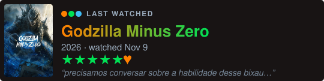

# Hi, I'm Vitor 👋

AI/ML engineer with 5 years of production ML and LLM systems in fintech (Nubank, fraud for a US bank). Open to remote roles.

More about me on 🌐 **[jvitorcosta.github.io](https://jvitorcosta.github.io)**

### Some of my work
- **[car-cyberdeck](https://github.com/jvitorcosta/car-cyberdeck)**: a taste of Pokémon nostalgia on my car's dashboard (ESP32, C++)
- **[car-can-lab](https://github.com/jvitorcosta/car-can-lab)**: listening to my car's CAN bus over Bluetooth to find its signals (ESP32, Python)
- **[or-solver-streamlit](https://github.com/jvitorcosta/or-solver-streamlit)**: SolvedOR, my bachelor thesis, an app that teaches Operations Research. [Try it live](https://solvedor.streamlit.app) (Python, Streamlit, OR-Tools)
- **[ask-vitor](https://github.com/jvitorcosta/ask-vitor)**: ask a local LLM about me; it answers only from my CV and says so when it doesn't know (FastAPI, Ollama)
- **[python-uv-claude-template](https://github.com/jvitorcosta/python-uv-claude-template)**: how I start every Python project
- **[timeseries-analysis-streamlit](https://github.com/jvitorcosta/timeseries-analysis-streamlit)**: shows where a daily forecast goes wrong: by series, weekday and holiday, and against a benchmark. [Try it live](https://forecast-error-analysis.streamlit.app) (Python, Streamlit, Plotly)

### Lately I've been pushing to
<!-- RECENT:START -->
- [timeseries-analysis-streamlit](https://github.com/jvitorcosta/timeseries-analysis-streamlit): Streamlit app that shows where a daily forecast goes wrong: by series, weekday, holiday and benchmark · Nov 14
- [jvitorcosta.github.io](https://github.com/jvitorcosta/jvitorcosta.github.io): My corner of the internet: what I'm listening to, watching and reading, and the gadgets I build. Static, rebuilt daily · Nov 14
- [ask-vitor](https://github.com/jvitorcosta/ask-vitor): Ask questions about me: a FastAPI service that answers with a local LLM (Ollama), grounded only in my CV · Nov 14
- [curriculum-vitae](https://github.com/jvitorcosta/curriculum-vitae) · Nov 13
- [car-cyberdeck](https://github.com/jvitorcosta/car-cyberdeck): A car cyberdeck: ESP32 touchscreens and a Garmin watch app that control the car's inside and outside LED lights by touch, gamepad, voice or watch, synced to Spotify · Nov 13
<!-- RECENT:END -->

📫 [LinkedIn](https://www.linkedin.com/in/jvpro/) · joaovpro17@gmail.com

 

<picture>
  <source media="(prefers-color-scheme: dark)" srcset="https://raw.githubusercontent.com/jvitorcosta/jvitorcosta/output/github-snake-dark.svg">
  <source media="(prefers-color-scheme: light)" srcset="https://raw.githubusercontent.com/jvitorcosta/jvitorcosta/output/github-snake.svg">
  
</picture>

  
  

Card by <a href="https://github.com/Leorev01/pokemon-profile-card">pokemon-profile-card</a> · snake by <a href="https://github.com/Platane/snk">Platane/snk</a> · now playing by <a href="https://github.com/novatorem/novatorem">novatorem</a> · "Lately" section and Letterboxd card refreshed daily by GitHub Actions
