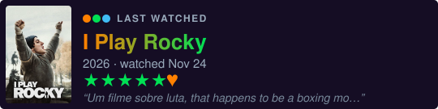

<picture>
  <source media="(prefers-color-scheme: dark)" srcset="assets/header-dark.svg">
  <source media="(prefers-color-scheme: light)" srcset="assets/header-light.svg">
  
</picture>

**🌐 [Portfolio](https://jvitorcosta.github.io)** · **💼 [LinkedIn](https://www.linkedin.com/in/jvpro/)** · **📄 [Resume (PDF)](https://jvitorcosta.github.io/Vitor_Pinheiro_Resume.pdf)** · ✉️ joaovpro17@gmail.com

<!-- NOW:START -->
**Now** · 🔨 building [jvitorcosta.github.io](https://github.com/jvitorcosta/jvitorcosta.github.io) · 🎧 listening: live card below · 🎬 watching I Play Rocky
<!-- NOW:END -->

I'm an AI/ML engineer. For five years I've shipped machine learning and LLM systems to production in fintech: fraud models at Nubank and for a US bank. Open to remote roles.

  
  
  

## Projects

<!-- PROJECTS:START -->
- **[car-cyberdeck](https://github.com/jvitorcosta/car-cyberdeck)**: a taste of Pokémon nostalgia on my car's dashboard · ESP32, C++ · pushed Nov 25
- **[car-can-lab](https://github.com/jvitorcosta/car-can-lab)**: listening to my car's CAN bus over Bluetooth to find its signals · ESP32, Python · pushed Nov 5
- **[or-solver-streamlit](https://github.com/jvitorcosta/or-solver-streamlit)**: SolvedOR, my bachelor thesis: an app that teaches Operations Research · Python, OR-Tools · pushed Nov 17 · [live](https://solvedor.streamlit.app)
- **[timeseries-analysis-streamlit](https://github.com/jvitorcosta/timeseries-analysis-streamlit)**: shows where a daily forecast goes wrong: by series, weekday, holiday and benchmark · Python, Plotly · pushed Nov 14 · [live](https://forecast-error-analysis.streamlit.app)
- **[ask-vitor](https://github.com/jvitorcosta/ask-vitor)**: ask a local LLM about me; it answers only from my CV and says so when it doesn't know · FastAPI, Ollama · pushed Nov 14
- **[python-uv-claude-template](https://github.com/jvitorcosta/python-uv-claude-template)**: how I start every Python project · Python, uv · pushed Nov 5
<!-- PROJECTS:END -->

## Last 12 months of commits

<picture>
  <source media="(prefers-color-scheme: dark)" srcset="assets/skyline-dark.svg">
  <source media="(prefers-color-scheme: light)" srcset="assets/skyline-light.svg">
  
</picture>

Cards and skyline drawn by [scripts/profile_art.py](scripts/profile_art.py) from my own GitHub data, the skyline inspired by gitskins Contribution City and Neon Skyline · now playing by [novatorem](https://github.com/novatorem/novatorem) · everything refreshed daily by GitHub Actions
